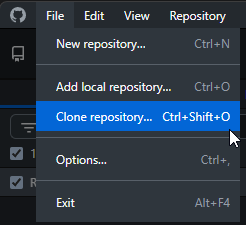
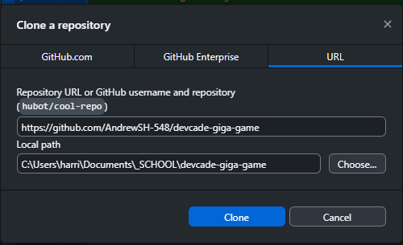
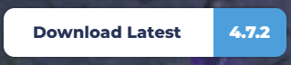

# World of Wallhoppers - Devcade Gigagame

World of Wallhoppers (Also known as Gigagame) is a 2D Arcade platformer and racing game, made for the Devcade Arcade Cabinet

## Getting Started

### Downloading the Project

To download the project, you'll want to use Git to clone it. If you don't know how to use git, I'd recommend Github desktop, as it's a GUI based off of git, which should help you learn how to use Git and Github. It can be downloaded at [desktop.github.com/download](desktop.github.com/download).
Once Github Desktop is downloaded, you'll have to login to your Github account, which should be the one you want to use to contribute to the game.

You'll want to "clone" the project, which means you'll download a copy of the full repository (the project) to your computer. To do this on github desktop, navigate to "File", then click "Clone Repository"

In the window that pops up, click the "URL" tab, and paste the URL for the Gigagame repository [github.com/AndrewSH-548/devcade-giga-game](github.com/AndrewSH-548/devcade-giga-game) into the first text box. Then choose the location for the project to be cloned to.

Then click "Clone", and the project will be downloaded onto your computer. Move onto the [Downloading Godot](#downloading-godot) section below if you don't have Godot 4.7 installed, otherwise you should read the [Contributing Changes](documentation/contributing-changes.md) page, as it goes over the specific way to contribute changes to the Gigagame repository 

### Downloading Godot
If you want to contribute to the project, you'll need to download Godot. Currently, the project uses Godot 4.7

To download Godot, first go to the Godot downloads page at: [godotengine.org/downloads](godotengine.org/downloads). The website will automatically bring you to the downloads page for your computer's platform.
Next, click the "Godot Engine" download button.

IMPORTANTLY, do not download the ".NET" version, as that uses C# alongside GDScript, which Gigagame is not built for.
After downloading Godot, it will just be an executable in a .zip file, which you can place wherever you wish.

This is all you need to download Godot! Importantly, if you haven't checked it out yet, you should read the [Contributing Changes](documentation/contributing-changes.md) page, as it goes over the specific way to contribute changes to the Gigagame repository. If you need help getting the project downloaded and git setup, check out the [Downloading the Project](#downloading-the-project) section.

### Documentation

Check out these for more info on contributing to Gigagame! Reading the [Contributing Changes](documentation/contributing-changes.md) is recommended!

- [Contributing Changes](documentation/contributing/contributing-changes.md)
- ETC