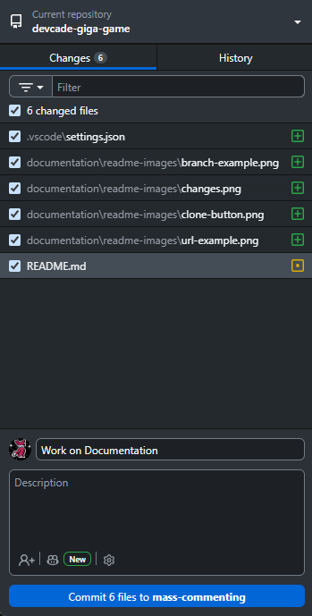
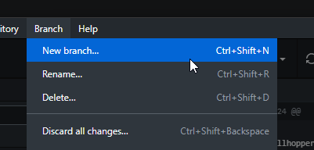

# World of Wallhoppers - Devcade Gigagame

World of Wallhoppers (Also known as Gigagame) is a 2D Arcade platformer and racing game, made for the Devcade Arcade Cabinet

## Getting Started

### Downloading the Project

To download the project, you'll want to use Git to clone it. If you don't know how to use git, I'd recommend Github desktop, as it's a GUI based off of git, which should help you learn how to use Git and Github. It can be downloaded at [desktop.github.com/download](desktop.github.com/download).
Once Github Desktop is downloaded, you'll have to login to your Github account, which should be the one you want to use to contribute to the game.

You'll want to "clone" the project, which means you'll download a copy of the full repository (the project) to your computer. To do this on github desktop, navigate to "File", then click "Clone Repository"

In the window that pops up, click the "URL" tab, and paste the URL for the Gigagame repository [github.com/AndrewSH-548/devcade-giga-game](github.com/AndrewSH-548/devcade-giga-game) into the first text box. THen choose the location for the project to be cloned to.

Then click "Clone", and the project will be downloaded onto your computer. Move onto the [Downloading Godot](#downloading-godot) section below if you don't have Godot 4.7 installed, otherwise you should read the [Contributing Changes](#contributing-changes) section, as it goes over the specific way to contribute changes to the Gigagame repository 

### Downloading Godot
If you want to contribute to the project, you'll need to download Godot. Currently, the project uses Godot 4.7

To download Godot, first go to the Godot downloads page at: [godotengine.org/downloads](godotengine.org/downloads). The website will automatically bring you to the downloads page for your computer's platform.
Next, click the "Godot Engine" download button.

IMPORTANTLY, do not download the ".NET" version, as that uses C# alongside GDScript, which Gigagame is not built for.
After downloading Godot, it will just be an executable in a .zip file, which you can place wherever you wish.

This is all you need to download Godot! Importantly, if you haven't checked it out yet, you should read the [Contributing Changes](#contributing-changes) section, as it goes over the specific way to contribute changes to the Gigagame repository. If you need help getting the project downloaded and git setup, check out the [Downloading the Project](#downloading-the-project) section.

### Contributing Changes

When you make changes, Github Desktop will update with a list of all the changes you have made to the files since your last "commit"

A "commit" is when you set your changes into your local repository. Basically, it's like making a progress "checkpoint", which can be reverted to at any point. You can commit your current changes by pressing the blue commit button underneath your changes. It's good practice to commit your changes every time you make good progress, and before you do something that could cause problems. Do note, that these commits are **not sent to the online repository** yet. When you have commits that aren't sent to the remote (online) repository, y

In the Gigagame repository, you cannot directly send your changes to the main branch. Instead, you'll have to make a branch for the changes you want to make, then make a pull request for adding those changes to the main project.

#### How Branches work

In git, branches are a way to separate work across many people, without running into conflicts when two people work on the project at the same time. For example, if I wanted to add an "Apple" item to the game, I could make a branch named "adding-apple-item". If I switch to that branch, and add the apple item to the game, my changes will only appear in the adding-apple-item branch. When I'm done adding the item, I can create a "Pull Request". Pull requests are a way to "pull" the changes you made back into the main branch, and therefore adding your changes to the game. When making a pull request, you can add a Title and Description for it, and these should generally reflect the changes you have made in that branch. In the Gigagame repository, once a pull request has been created, it cannot immediately be merged into the main branch. Instead, someone has to "review" your changes, and then approve them, to let it be merged. Anyone else in the Repository can approve pull requests.

To create a branch in Github Desktop, you can navigate to the "Branch" tab, and click "New Branch"

[]

When you are read