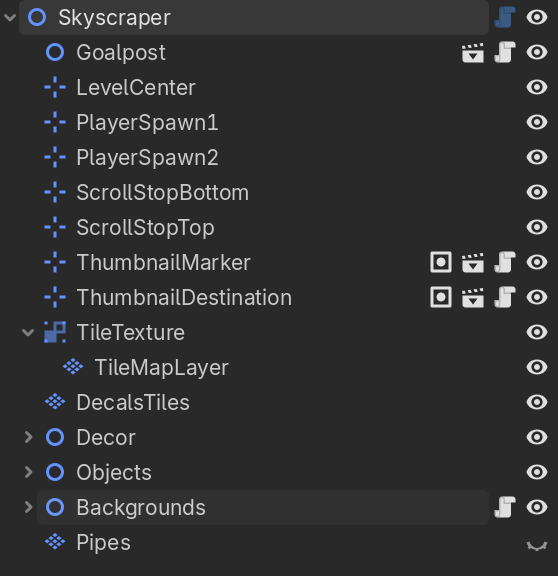
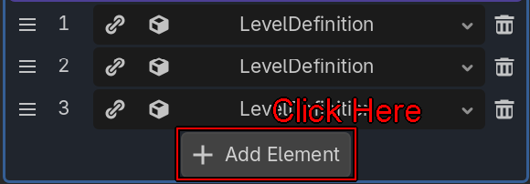
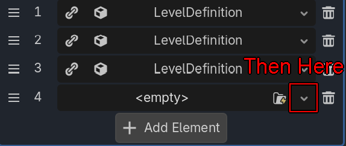
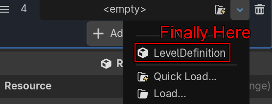
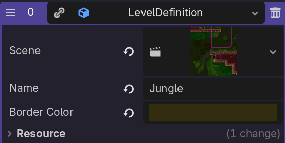

# Levels

Levels are all defined by their .tscn Scene file, as well as their information in the game_definitions.tres file

## Structure of a Level Scene

Each level scene's root node inherits from the Level class, and needs some specific children to function properly. The names of these children must be exactly as shown below (except for the Thumbnail Markers, which are identified by their classes):

- **LevelCenter**:
A Marker 2D node which provides the horizontal center of the level for camera positioning
- **PlayerSpawn1 and PlayerSpawn2**:
The spawn points for the first and second players. Currently these are both always at the same position, and having two nodes is a holdover from legacy versions, so it is expected to change
- **ScrollStopBottom and ScrollStopTop**: The camera will not scroll underneath ScrollStopBottom, and will not scroll above ScrollStopTop
- **ThumbnailMarker**:
Used in the Level Select menu, it marks the start of the "scrolling" effect shown when hovering over the level
- **ThumbnailDestination**:
Similar to "ThumbnailMarker", but instead marks the end of the scrolling effect

Each level should also have the following nodes, though they will not crash without them:

- **Goalpost**:
The goalpost scene triggers the end of the race when touched. While multiple goals can be added without problem, there should only be one per level

- **Backgrounds**:
For any parallax backgrounds, you must use a node inheriting the custom Backgrounds class. Any direct children "Parallax2D" nodes will be duplicated to work across both screen in splitscreen automatically. If you need to have parallax nodes that are not direct children of the Backgrounds node, you can use the "Extra Background Holders" array property to select them directly.

 

    
     <i>Layout of the Skyscraper Level</i>

## Level Content

For the gameplay content of a level, while there is no set rules, we generally try to keep up these principles:

- Around 2-3 unique gameplay elements per level
- Time to complete a good run should be around 25 seconds
- Unique mechanics should be quick to understand, and should work well with the other unique elements added, though they don't have to directly interact
- Avoid making the player wait for things to happen

Currently the levels each use TileMapLayers to construct their solid foundation, and use scenes to add elements and enemies, however any approach can be taken, as long as it is not buggy, and performs well on the Devcade Arcade Cabinet

## Adding a Level to the Game

Once the scene has been created, adding a level to the game is very simple. In Godot, double click the "game_definitions.tres" file, which can be found at assets/data/game_definitions.tres. In the inspector, you'll see two arrays: "Characters" and "Levels". Ignore Characters, and click on Levels to expand it if it is not already expanded. Click on "Add Element", and in the empty element that appears, then click the dropdown arrow, and finally click "LevelDefinition"

     
     
    

Now, click the Level Definition you just made, and it should expand showing the three needed fields:
- **Scene**: This is a reference to the scene file of the level. You can either select it through the dropdown, or drag-and-drop it from the filesystem view
- **Name**: The in-game name of the Level
- **Border Color**: In singleplayer, the out-of-bounds is a solid border, and the color of that border is determined here, per-level. Generally this should be a color from the palette of the tileset used for the ground of the level, but it should just generally look nice, and fit the theming of the level

    
     <i>Level Definition for "Jungle"</i>

